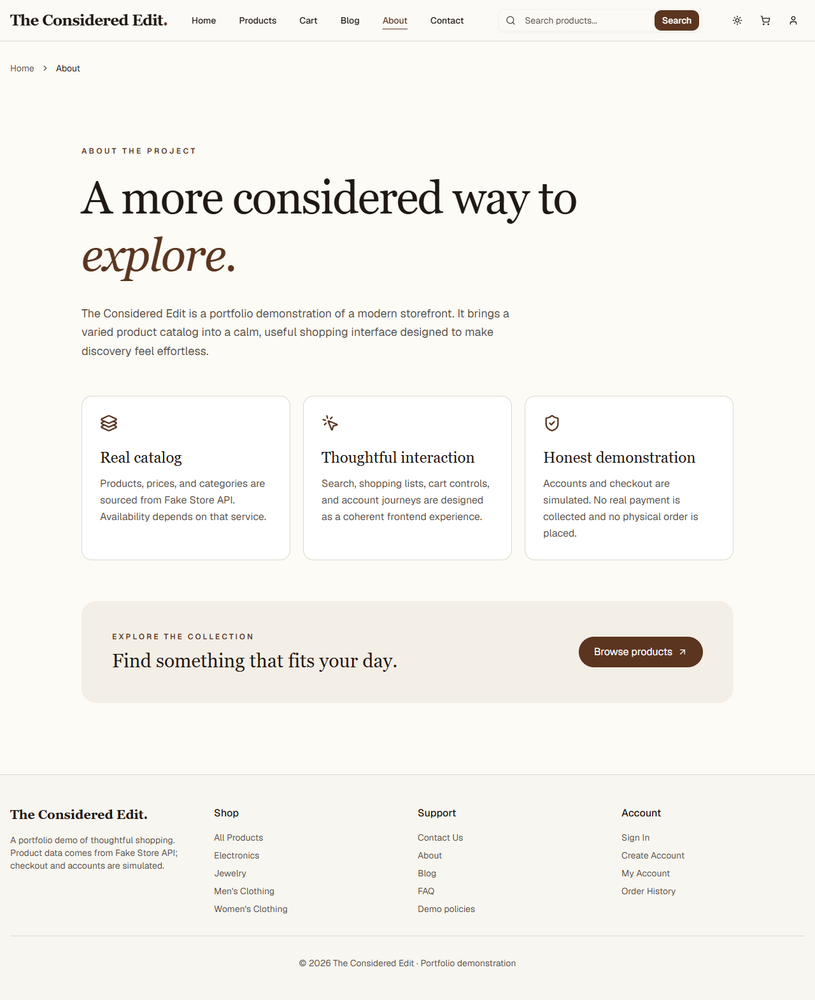

# Morrow

A portfolio storefront built with Next.js App Router, React, TypeScript, and Tailwind CSS. It showcases a responsive catalog, product detail pages, cart and wishlist interactions, editorial pages, and a complete **demo** account and checkout flow.



Mobile and dark theme captures are in [docs/screenshots](docs/screenshots).

## What is real and what is simulated

Products are requested from [Fake Store API](https://fakestoreapi.com/). Account sessions, checkout, and orders are browser-only demonstrations. No payment is collected, no goods ship, and no message is sent. Catalog availability depends on the external API.

## Run locally

Requirements: Node.js 20.9 or newer and pnpm.

```bash
pnpm install --frozen-lockfile
pnpm dev
```

Open [http://localhost:3000](http://localhost:3000). To create a demo session, use the registration page or log in with username `demo`, email `demo@example.com`, and password `demo12345`. Use only demonstration information.

## Checks

```bash
pnpm typecheck
pnpm lint
pnpm test:unit
pnpm api:check
pnpm test:e2e
pnpm format:check
pnpm build
```

## Project map

- `app/`: routes, metadata, and global styling
- `components/`: storefront, account, cart, and UI components
- `services/productService.ts`: Fake Store API access and response validation
- `lib/demo-orders.ts`: local demonstration order persistence
- `lib/catalog.ts` and `lib/cart-pricing.ts`: tested catalog and pricing rules
- `docs/`: architecture, demo behavior, development, and agent guidance

## Limitations

Fake Store API is a small demonstration catalog and may be unavailable. Catalog requests run in the browser using the API's documented browser request pattern. `pnpm api:check` diagnoses server-side reachability, which can differ from browser access if Cloudflare challenges server requests. See [API diagnostics](docs/API.md). Browser state is local to this device; it is not a secure commerce backend. The project has no live inventory, payment processing, shipping integration, or transactional email. See [architecture](docs/ARCHITECTURE.md), [demo authentication](docs/DEMO-AUTHENTICATION.md), and [demo checkout](docs/DEMO-CHECKOUT.md).
