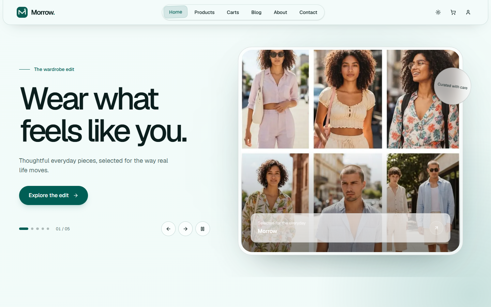
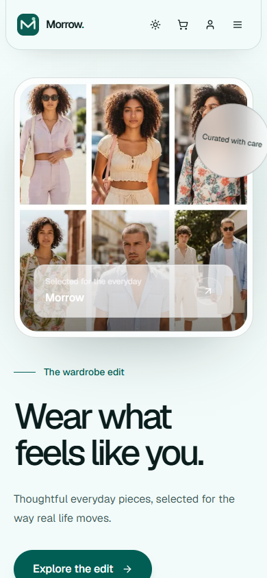
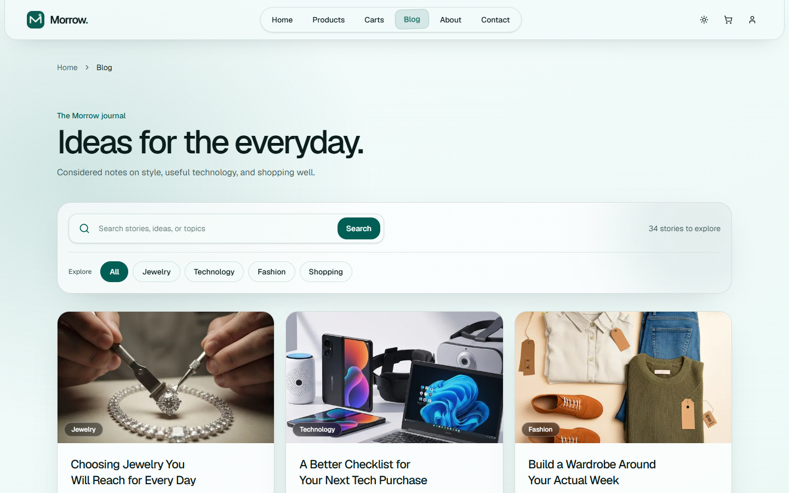
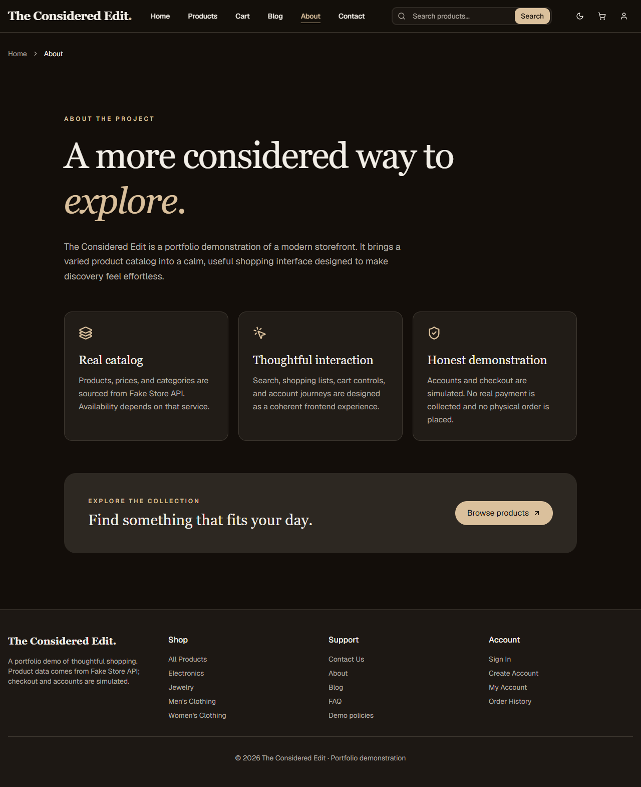

# Morrow

**A responsive portfolio storefront for discovering everyday style, jewelry, and technology.** Built with Next.js App Router, React, TypeScript, and Tailwind CSS.

**[Explore the live demo](https://e-commerce-g2za.vercel.app/)** · [Features](#features) · [Run locally](#run-locally) · [Project structure](#project-structure)

## Website preview

These screenshots are stored in this repository, so they render directly in the GitHub README.

| Home · desktop                                                    | Home · mobile                                                   |
| ----------------------------------------------------------------- | --------------------------------------------------------------- |
|  |  |

| Journal                                                                            | About · dark theme                                                                  |
| ---------------------------------------------------------------------------------- | ----------------------------------------------------------------------------------- |
|  |  |

More views: [About in light mode](docs/screenshots/about-light-desktop-chromium.png) · [About on mobile](docs/screenshots/about-dark-mobile-chromium.png)

## Overview

Morrow is a frontend portfolio project that presents a complete shopping journey: browse a live product catalog, inspect a product, save favorites, manage a bag, and place a **demo** order. It also includes an editorial journal, account screens, and separate views for exploring Fake Store API resources. The interface uses a responsive glass header, light and dark themes, considered typography, and motion that respects reduced-motion preferences.

Products come from [Fake Store API](https://fakestoreapi.com/). Accounts, wishlist, cart, checkout, orders, contact submissions, and newsletter feedback are demonstrations. There is no production authentication, payment processing, inventory, shipment, or email delivery.

## Features

### Discover products

- Browse products and categories with search, price, rating, sorting, and page-size controls. Catalog filters are reflected in the URL so views can be shared.
- Open a product detail page with ratings, descriptions, quantity controls, wishlist actions, and an image gallery. When the API supplies one photo, the gallery also shows clearly labeled **AI-generated concept views**; they may differ from the real item.
- Explore public sample carts and their products, with filters and pagination. A signed-in demo user can copy available items from a sample cart into their local bag.

### Try the demo shopping flow

- Manage bag quantities, remove items, and try demo promotion codes.
- Complete a checkout with fictional contact and shipping details and a demo payment choice. The form never asks for card details.
- View an order confirmation and browser-local order history. No payment is charged and no order is submitted to a commerce backend.
- Create a browser-only demo session, edit a local profile, and keep a wishlist. Public sample API login is also available; its token and entered password are discarded.

### Explore the rest of the site

- Read 34 local journal articles with search, topic filters, pagination, and related stories.
- Visit the About, FAQ, and Contact pages. Contact and newsletter forms show local demo feedback without sending a message or subscribing an address.
- Inspect Fake Store API product, cart, and user resources on dedicated demo pages. Sample write requests do not persist changes to the storefront.
- Use the site on desktop and mobile, switch between English and Persian with the flags beside the theme control, and navigate with a keyboard. Persian uses a right-to-left layout and local Persian editorial copy; product and public sample API records retain their English source text. Shared loading, error, empty-state, and back-to-top controls support the page flows.

## Technology

| Area           | Tools                                                                      |
| -------------- | -------------------------------------------------------------------------- |
| Application    | Next.js App Router, React, TypeScript                                      |
| Styling and UI | Tailwind CSS, Radix UI, Lucide icons, Framer Motion                        |
| Data           | Fake Store API, TanStack Query, Zod validation                             |
| Quality        | ESLint, Prettier, TypeScript, Node.js unit tests, Playwright browser tests |

## Run locally

Use Node.js **20.9 or newer** and pnpm:

```bash
pnpm install --frozen-lockfile
pnpm dev
```

Open <http://localhost:3000>. Environment overrides are optional; see [.env.example](.env.example). Product availability depends on Fake Store API and the browser's ability to reach it.

For a local demo session, choose **Demo account** on the sign-in page and use:

| Field    | Demo value         |
| -------- | ------------------ |
| Username | `demo`             |
| Email    | `demo@example.com` |
| Password | `demo12345`        |

Use fictional details only. This session is a browser demonstration, not server-side authorization.

## Project structure

| Path          | Responsibility                                                                |
| ------------- | ----------------------------------------------------------------------------- |
| `app/`        | App Router pages, route loading and error boundaries, metadata, global styles |
| `components/` | Feature views, shared layout, feedback, and UI primitives                     |
| `services/`   | Fake Store API requests and error handling                                    |
| `lib/`        | Product schema, catalog rules, cart pricing, and browser demo state helpers   |
| `data/`       | Static editorial and FAQ content                                              |
| `lib/i18n/`   | Locale preference and interface translations                                  |
| `public/`     | Site imagery and labeled product concept views                                |
| `tests/`      | Unit and browser flow checks                                                  |

See [project structure](docs/PROJECT-STRUCTURE.md) and [architecture](docs/ARCHITECTURE.md) for more detail.

## Verify the project

```bash
pnpm typecheck
pnpm lint
pnpm test:unit
pnpm test:e2e
pnpm build
```

Run `pnpm api:check` when diagnosing API access. A server-side 403 can occur if the external provider presents a browser security challenge; it does not necessarily mean the browser catalog will fail. See [API diagnostics](docs/API.md).

## Demo scope and documentation

Morrow is a portfolio demonstration. Browser storage can be cleared to reset local sessions and orders. Public API sample writes are non-persistent, and external catalog requests may be unavailable at times. Read more about [demo authentication](docs/DEMO-AUTHENTICATION.md), [demo checkout](docs/DEMO-CHECKOUT.md), and the [feature inventory](docs/FEATURES.md).

The language preference is stored for one year in the `morrow-locale` browser cookie. Switching languages keeps the current URL, search filters, and browser demo data. Product names, descriptions, categories, and public sample records from Fake Store API are shown in English in both languages. The Persian journal is local demonstration editorial content; no external product data is translated.
